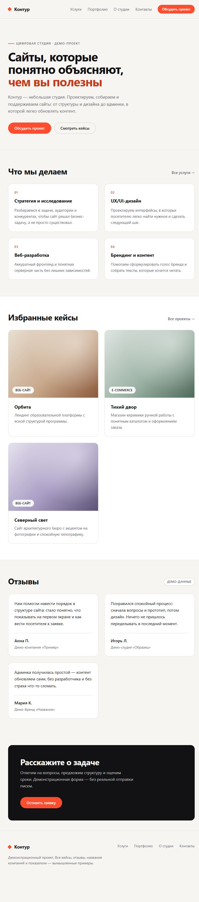
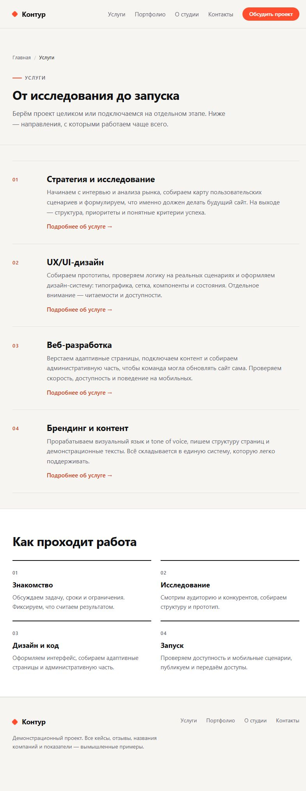
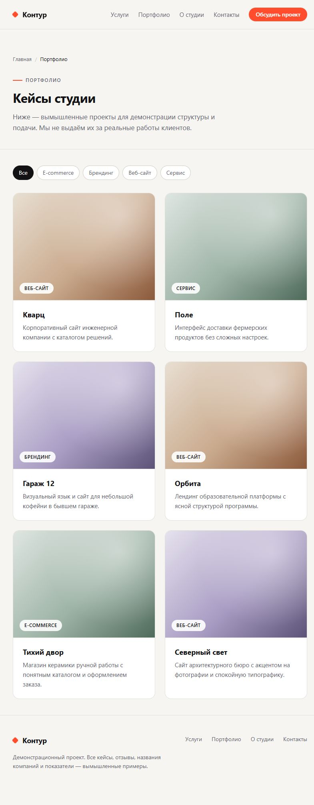
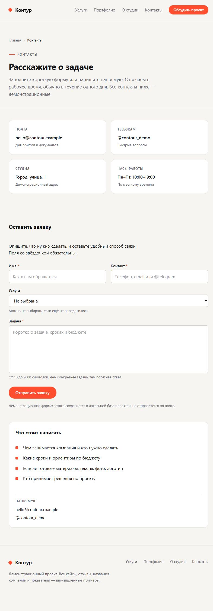
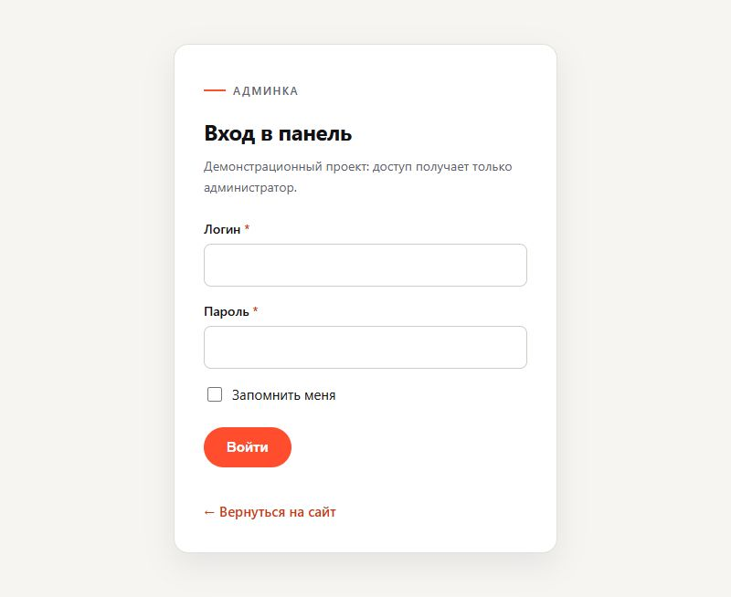
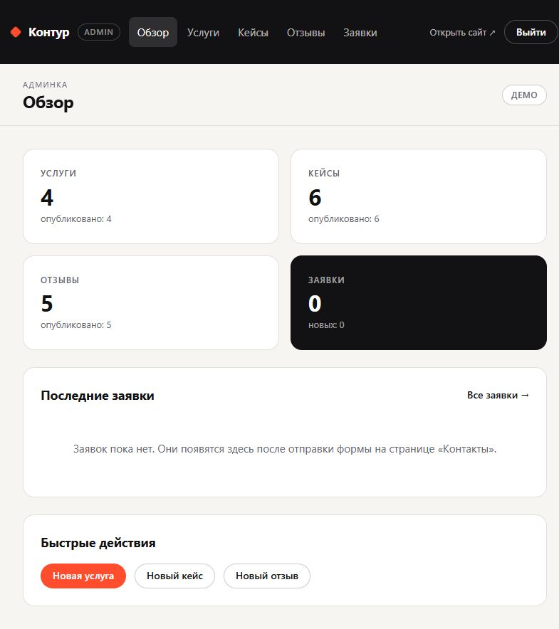

# Контур — сайт цифровой студии

Демонстрационный корпоративный сайт небольшой digital-студии с публичной
частью и админкой. Контент хранится в базе и редактируется без изменения кода.

> **Важно:** проект учебный. Все кейсы, отзывы, названия компаний, имена
> и результаты — вымышленные примеры. Сайт не выдаёт их за реальные работы.

## Возможности

**Публичная часть**

- Главная: hero, услуги, избранные кейсы, отзывы, CTA
- Услуги: список и детальные страницы
- Портфолио с фильтром по категориям и страницы кейсов
  (задача / решение / результат)
- О студии: принципы и команда
- Контакты с формой заявки и страницей успешной отправки
- Аккуратные пустые состояния, страницы 404/413/500

**Админка**

- Вход и выход, защита всех маршрутов
- CRUD услуг, кейсов и отзывов
- Публикация/скрытие, порядок отображения, «избранный» кейс
- Загрузка обложек кейсов (JPG/PNG/WebP, до 2 МБ)
- Заявки: список, фильтр по статусу, карточка, смена статуса
- Dashboard со счётчиками и последними заявками

**Качество**

- Серверная валидация форм и уникальные slug (транслитерация кириллицы)
- CSRF-защита, хеширование паролей, honeypot против спама
- Адаптивная вёрстка, доступные focus-состояния, `prefers-reduced-motion`
- 39 тестов на pytest

## Скриншоты

<table>
  <tr>
    <td></td>
    <td></td>
  </tr>
  <tr>
    <td></td>
    <td></td>
  </tr>
  <tr>
    <td></td>
    <td></td>
  </tr>
</table>

## Стек

- Python 3.11, Flask 3.1
- SQLAlchemy + SQLite
- Jinja2, HTML5, CSS3, ванильный JavaScript
- Flask-WTF (формы и CSRF), Flask-Login
- pytest

Без React и сборщиков — только Flask и шаблоны.

## Быстрый старт

```powershell
python -m venv .venv
.\.venv\Scripts\Activate.ps1
pip install -r requirements.txt

# необязательно: локальные переменные окружения
Copy-Item .env.example .env

# создать таблицы и демо-данные
flask --app run init-db
flask --app run seed

# создать администратора (логин и пароль спросит интерактивно)
flask --app run create-admin

# запустить
python run.py
```

Сайт: <http://127.0.0.1:5000>, админка: <http://127.0.0.1:5000/admin>.

`run.py` при старте создаёт папки `instance/` и `instance/uploads/`, а также
таблицы, если их ещё нет.

### Команды

| Команда | Назначение |
|---|---|
| `flask --app run init-db` | Создать таблицы |
| `flask --app run seed` | Заполнить пустые таблицы демо-данными |
| `flask --app run create-admin` | Создать администратора |
| `flask --app run set-password` | Сменить пароль администратора |
| `python run.py` | Запустить dev-сервер на `127.0.0.1:5000` |

## Переменные окружения

| Переменная | Обязательна | Описание |
|---|---|---|
| `SECRET_KEY` | В production — да | Ключ подписи сессий и CSRF |
| `DATABASE_URL` | Нет | По умолчанию `sqlite:///instance/app.db` |
| `ADMIN_USERNAME` | Нет | Задел для автоматизации, по умолчанию `admin` |
| `ADMIN_PASSWORD` | Нет | Задел для автоматизации |

Секрет можно сгенерировать так:

```powershell
python -c "import secrets; print(secrets.token_hex(32))"
```

Файл `.env` не попадает в git (см. `.gitignore`).

## Тесты

```powershell
.\.venv\Scripts\python.exe -m pytest -q
```

Покрыто:

- публичные маршруты, фильтры, 404 и скрытый контент;
- внутренние ссылки и базовая доступность (один `h1`, `lang="ru"`);
- валидация заявок, лимиты, honeypot, CSRF;
- доступ в админку, CRUD, slug-конфликты, загрузка изображений, статусы заявок;
- отказ при неверном формате и превышении размера файла, страница 413;
- транслитерация и уникальность slug.

Ожидаемый результат: `39 passed`.

## Структура проекта

```text
digital_agency/
├── app/
│   ├── __init__.py          # create_app, фильтры, обработчики ошибок
│   ├── extensions.py        # db, login_manager, csrf
│   ├── models.py            # Service, Project, Testimonial, Lead, AdminUser
│   ├── cli.py               # init-db, seed, create-admin, set-password
│   ├── forms/
│   │   ├── public.py        # LeadForm
│   │   └── admin.py         # LoginForm, CRUD-формы
│   ├── routes/
│   │   ├── public.py
│   │   └── admin.py
│   ├── services/
│   │   ├── slugs.py         # транслитерация и уникализация
│   │   ├── seed.py          # демо-данные
│   │   └── uploads.py       # безопасная загрузка файлов
│   ├── templates/
│   │   ├── public/
│   │   ├── admin/
│   │   ├── errors/
│   │   └── partials/
│   └── static/
│       ├── css/
│       └── js/
├── docs/
│   ├── 01_design.md         # этап проектирования
│   └── screenshots/
├── tests/
├── config.py
├── run.py
├── requirements.txt
├── pytest.ini
├── .env.example
├── .gitignore
└── README.md
```

## Как это устроено

- **Фабрика приложения** `create_app()` подключает расширения, blueprint'ы,
  CLI-команды и обработчики ошибок.
- **Публичный blueprint** отдаёт только опубликованные записи; неизвестный
  или скрытый slug — `404`.
- **Админский blueprint** защищён на уровне `before_request`; все изменения
  идут через POST с CSRF и flash-сообщением.
- **Slug** генерируется из названия с транслитерацией, коллизия получает
  суффикс `-2`, ручной дубль возвращает ошибку формы.
- **Заявки** сохраняются в БД и доступны в админке; honeypot отсекает ботов.
- **Изображения** кейсов хранятся в `instance/uploads/` под случайными
  именами и отдаются через `/media/<имя>`.

## Безопасность

- Пароли хранятся только в виде хеша (`werkzeug.security`).
- CSRF включён для всех форм; запросы без токена получают `400`.
- Админ-маршруты недоступны без авторизации.
- Все поля валидируются на сервере, длины ограничены.
- Загрузка файлов: белый список расширений, лимит 2 МБ, случайные имена,
  исполняемые файлы запрещены.
- Jinja2 экранирует пользовательский контент; `|safe` не используется.
- Секреты — только в переменных окружения.

Ограничения демо-версии: нет rate limiting и восстановления пароля,
рассчитано на одного администратора.

## Деплой

1. Задайте `SECRET_KEY` и `DATABASE_URL` в окружении.
2. Выключите debug и не используйте встроенный сервер Flask в production.
   Например, с Waitress:

   ```powershell
   pip install waitress
   waitress-serve --call "app:create_app"
   ```

3. Настройте HTTPS и резервное копирование `instance/` (база и загрузки).
4. При необходимости смените пароль администратора:
   `flask --app run set-password`.

## Демо-контент

`flask --app run seed` добавляет 4 услуги, 6 кейсов и 5 отзывов. Все записи
вымышлены и помечены в интерфейсе как демонстрационные. Перед реальным
использованием замените их своим контентом.

## Лицензия

Учебный демонстрационный проект.
